## 定义与概念

CI（Continuous Integration，持续集成）

CI要求软件开发团队的每个人定期共享其对代码库的更改，并在每次更改后检查代码质量。持续集成是DevOps中构建和发布软件的关键，通过自动化的实现缩短了反馈周期，促进了团队协作。


### 核心定义

团队成员经常将代码变更合并到共享的主干分支（Main/Master Branch）中，每次合并都会通过**自动化的构建和测试**（如单元测试、静态分析）进行验证，以便及早发现并解决集成错误。

### 主要环节与流程

- **频繁提交**：开发人员每天多次将代码提交到代码仓库（如 Git）。
- **自动构建**：每次提交代码后，CI 工具（如 Jenkins, GitHub Actions, GitLab CI）会自动拉取代码并编译。
- **自动测试**：运行自动化测试套件，确保新提交的代码没有破坏现有功能。
- **反馈结果**：如测试失败，立即向团队发出通知并阻止不合格代码合入主干。

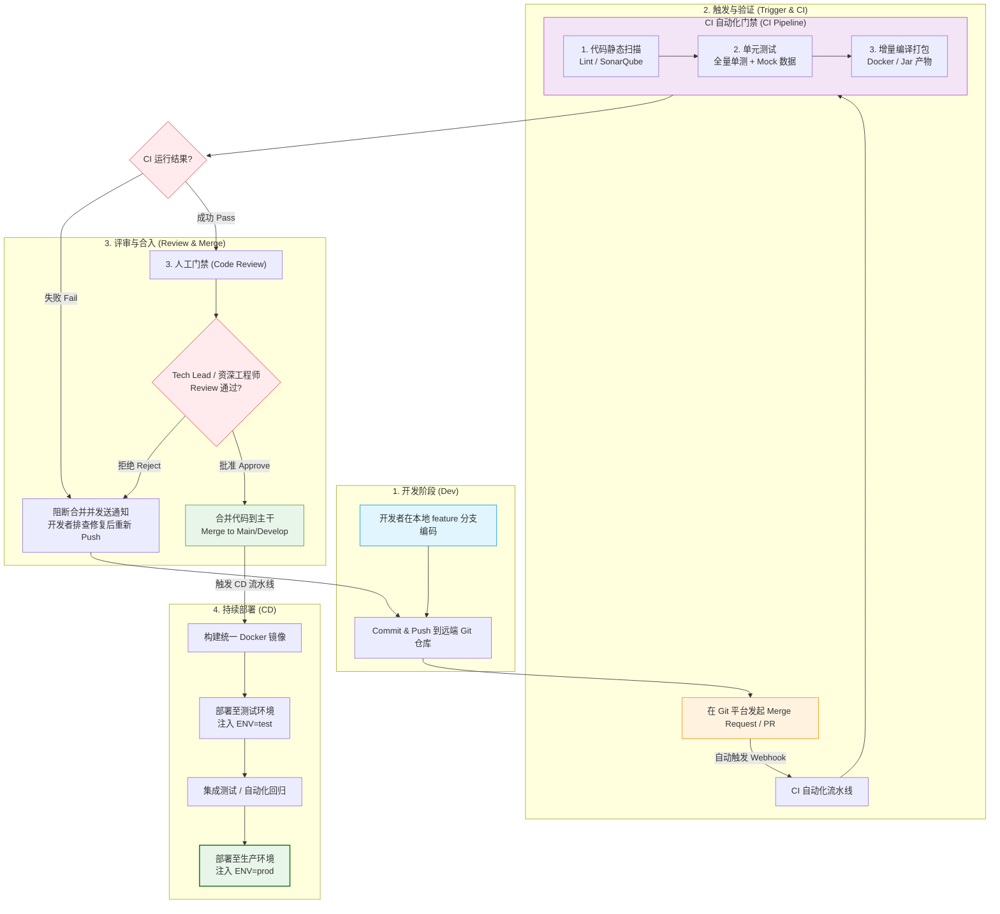

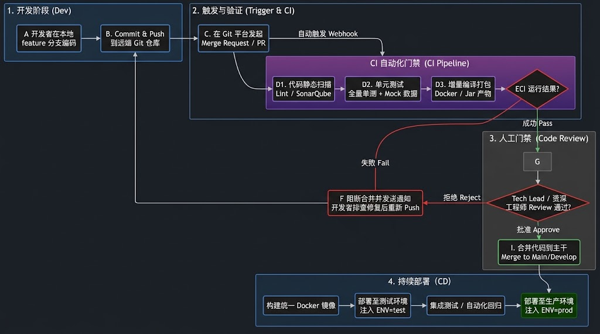

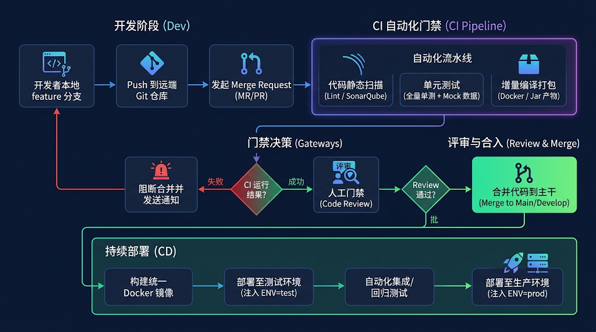


## 技术设计理念

### 解决的核心痛点

解决传统软件开发中“集成地狱”（Integration Hell）的问题，即多名开发者长期独立开发后再统一合并时产生的大量冲突与 Bug。

### 核心可总结为以下几大关键原则

####  1.频繁提交，小步快跑（Small Increments, Frequent Commits）

**理念**：避免“巨型合并”（Big Bang Integration）。

**设计逻辑**：每次代码变更只聚焦于极小的逻辑单元（通常每天合并多次）。变更越小，潜在的代码冲突风险就越低，定位问题的范围和成本也越小。

#### 2. 单一事实来源（Single Source of Truth）

- **理念**：所有资产均须纳入版本控制。
- **设计逻辑**：不仅源代码要入库，构建脚本、环境配置文件、基础设施代码（IaC）、数据库变更脚本以及自动化测试用例等，都必须统一在版本控制系统（如 Git）中进行管理。任何人只要从仓库拉取最新代码，就能无缝在本地拉起相同的开发环境。

#### 3. 自动化一切（Automate Everything）

- **理念**：消除人工干预带来的不可靠性与效率瓶颈。
- **设计逻辑**：代码编译、静态检查、单元测试、集成测试、产物打包等整个生命流程，全部交由自动化工具链驱动。触发条件由代码提交或 Pull Request 自动触发，减少人为误操作。

#### 4. 快速失败与即时反馈（Fail Fast & Fast Feedback）

- **理念**：反馈越快，修复成本越低。
- **设计逻辑**：
  - **测试金字塔与流水线并行**：优先运行速度最快的静态检查与单元测试，将耗时较长、成本较高的端到端测试（E2E）或集成测试往后放。如果第一步报错，就立即终止流水线。
  - **目标阈值**：健康的 CI 流水线通常设计在 10 分钟内完成核心反馈，确保开发人员不会在等待构建结果时产生上下文切换成本。

#### 5. 保持主干可随时发布（Keep the Main Branch Clean/Green）

- **理念**：主干分支（Main/Master）时刻处于健康稳定的可构建状态。
- **设计逻辑**：
  - **阻断机制**：任何未通过 CI 验证的代码分支决不允许合入主干。
  - **“停止生产线”文化**：一旦主干构建失败，修复主干构建问题即成为团队最高优先级的任务，直到主干恢复正常前禁止合入新代码。

#### 6. 镜像化与环境一致性（Environment Parity）

- **理念**：彻底消除“在我机器上是好的”（It works on my machine）这种问题。
- **设计逻辑**：借助容器化技术（如 Docker）与标准化构建代理（Build Agents），确保 CI 运行的环境与开发者本地环境、测试环境以及生产环境保持高度一致。


## 常见开源软件以及核心设计架构

### 1. 常见的开源 CI 软件

| **软件名称**       | **技术栈** | **特点与适用场景**                                           |
| ------------------ | ---------- | ------------------------------------------------------------ |
| **Jenkins**        | Java       | **行业老牌巨头**。拥有极为丰富的插件生态（超过1800+），扩展性强；支持流水线即代码（Jenkinsfile）；适合复杂企业级私有部署。 |
| **GitLab CI/CD**   | Go / Ruby  | **一体化 DevOps 平台**。与 GitLab 代码仓库深度无缝集成；基于 `.gitlab-ci.yml` 声明式配置，上手简单、维护成本低。 |
| **Woodpecker CI**  | Go         | **极简轻量级容器化 CI**（Drone 的开源分支）。天然基于 Docker/Container 运行，通过 `.woodpecker.yml` 配置，资源占用极小，适合追求轻量高效的团队。 |
| **Tekton**         | Go         | **Kubernetes 原生 CI/CD 框架**。Cloud Native Computing Foundation (CNCF) 项目；以 CRD（自定义资源定义）方式将流水线建模为 K8s 原生资源，适合 Serverless/云原生架构。 |
| **Argo Workflows** | Go         | **K8s 原生工作流引擎**。虽然常用于数据处理与机器学习，但在云原生 CI/CD 编排领域也极受青睐，完美支持大规模分布式任务编排。 |

### 2. CI 软件的核心设计架构

绝大多数现代化 CI 软件在底层架构上都遵循 **“主控协调者 + 弹性执行节点”（Controller-Worker / Master-Agent）** 的设计范式。

#### 通用架构流程全景图

```
[ Git 仓库 (GitHub/GitLab) ]
               │
               │ (1. Webhook 触发)
               ▼
┌──────────────────────────────────────────────────────────┐
│                   1. 事件触发与接入层                    │
└──────────────────────────┬───────────────────────────────┘
                           │
                           ▼
┌──────────────────────────────────────────────────────────┐
│                   2. 控制层 / 调度中心                  │
│   - DSL 解析    - DAG 拓扑图计算    - 任务队列调度      │
└──────────────┬────────────────────────────┬──────────────┘
               │                            │
  (2. 下发任务)│                            │(状态/日志)
               ▼                            ▼
┌──────────────────────────────┐  ┌────────────────────────┐
│     3. 执行层 (Agent/Worker)  │  │   4. 数据与数据流层    │
│ ┌──────────────────────────┐ │  │ - 元数据库            │
│ │  沙箱环境 (Container/Pod) │ │  │ - 依赖缓存 (Cache)    │
│ │  - Step 1: Git Checkout  │ │◄─┼─- 产物仓库 (Artifact) │
│ │  - Step 2: Test & Build  │ │  └────────────────────────┘
│ │  - Step 3: Push Artifact  │─┼───────────┐
│ └──────────────────────────┘ │           │
└──────────────────────────────┘           ▼
                                  ┌────────────────────────┐
                                  │ 5. 扩展与集成接口      │
                                  │ - 凭据中心 / 消息通知   │
                                  └────────────────────────┘
```


#### 四大核心架构模块

##### 1. 事件触发与接入层（Event & Trigger Layer）

- **职责**：监听上游代码变更，捕获触发信号并启动流水线。
- **通用机制**：
  - **Webhook 接收器**：暴露 HTTP Endpoint，实时接收 Git 托管平台（GitHub、GitLab、Gitee）推送的 `push`、`pull_request`、`tag_push` 等事件。
  - **定时与轮询（Cron/Polling）**：针对夜间构建（Nightly Build）或不支持 Webhook 的环境。
  - **过滤器（Event Filter）**：根据分支（Branch）、匹配路径（Path）、标签（Tag）或 Commit 信息判断是否需要触发真实构建。

##### 2. 控制层 / 调度中心（Control Plane & Scheduler）

- **职责**：整个 CI 系统的“大脑”，负责状态维护与任务编排。
- **通用机制**：
  - **DSL/YAML 解析器**：读取并解析代码库中的流水线配置文件（如 `.gitlab-ci.yml`、`Jenkinsfile`、`.woodpecker.yml`）。
  - **DAG 拓扑构建**：将配置文件中的 `Stages`（阶段）和 `Jobs/Tasks`（任务）转化为**有向无环图（DAG）**，计算出任务之间的并行与先后依赖关系。
  - **任务队列（Task Queue）**：将待执行的任务放入全局队列（如 Redis、数据库或内存队列）。
  - **节点调度（Node Scheduler）**：根据任务所需的标签（Labels）、资源限制（CPU/Memory）以及 Agent 的负载情况，将任务分配给合适的 Worker/Agent。

##### 3. 执行层 / 沙箱节点（Execution Plane & Agent/Worker）

- **职责**：系统的手脚，负责在隔离环境中真正运行代码构建、测试和打包逻辑。
- **通用机制**：
  - **环境沙箱（Sandbox Isolation）**：
    - **容器化模式（主流）**：每次构建动态拉起一个全新的 Docker 容器或 K8s Pod，构建完成后立即销毁，保证环境绝无污染。
    - **宿主机/虚拟机模式**：在固定的物理机、VM 或 Mac 节点上直接运行（常用于 iOS/macOS 等无法容器化的构建场景）。
  - **日志收集器（Log Streamer）**：实时捕获终端的 `stdout` 和 `stderr` 标准输出，利用 WebSocket 或 gRPC 实时分块（Chunking）回传给控制层展现。
  - **心跳与状态上报（Heartbeat & Health Check）**：Agent 定期向 Server 报告自己的健康状况与当前任务进度。

##### 4. 数据与数据流层（Data & Artifact Management）

- **职责**：处理构建过程中的数据流动、状态持久化与产物存取。
- **通用机制**：
  - **元数据库（Metadata DB）**：存储用户凭据、流水线历史记录、任务执行状态（Success/Failed/Running）。
  - **依赖缓存系统（Caching Subsystem）**：将重型依赖包（如 `node_modules`、`~/.m2`、`~/.cache/go-build`）打包压缩并推送到中心存储（如 S3/MinIO），跨任务或跨构建解压复用，加速构建。
  - **产物仓库（Artifact Store）**：收集构建阶段生成的编译结果（如 `.jar`、二进制文件、测试报告）并提供下载与续接服务。

##### 5. 扩展与集成接口（Extension & Integration Layer）

- **职责**：解耦核心逻辑，接入丰富的第三方生态。
- **通用机制**：
  - **凭据管理（Secrets Management）**：与 HashiCorp Vault、AWS Secrets Manager 或系统自带凭据库对接，在构建时动态注入环境变量（如 Token、密码、私钥），且在日志中自动脱敏。
  - **通知系统（Notifier）**：任务结束（特别是 Failure）后，向钉钉、飞书、Slack、邮件发送通知。
  - **插件/ Step 运行器**：通过容器化镜像（如 Drone/Actions）或共享动态库（如 Jenkins）扩充特定构建步骤（如“扫描SonarQube”、“推送镜像到Harbor”）。


## 常见招聘要求

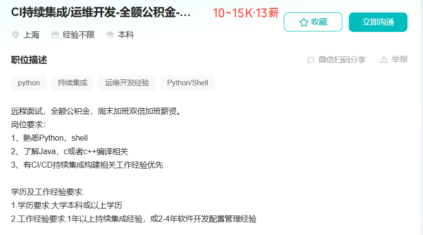

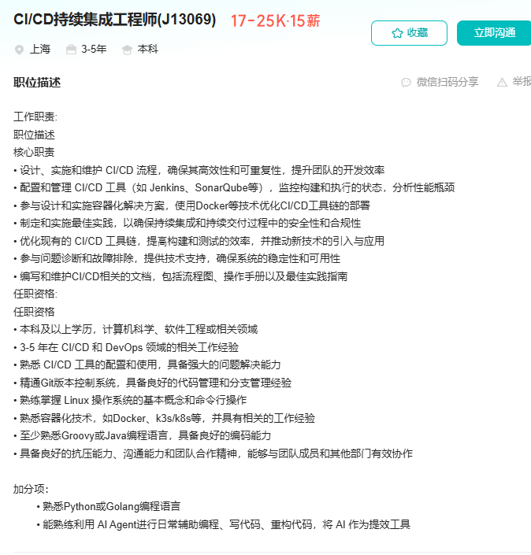

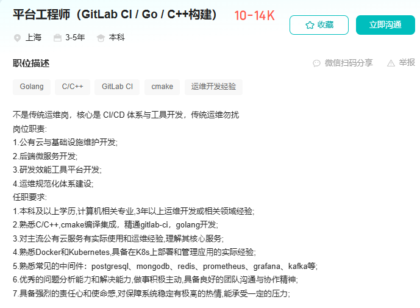


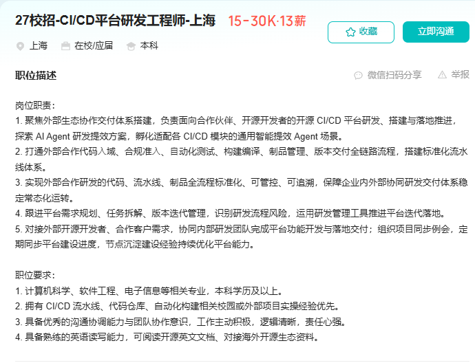

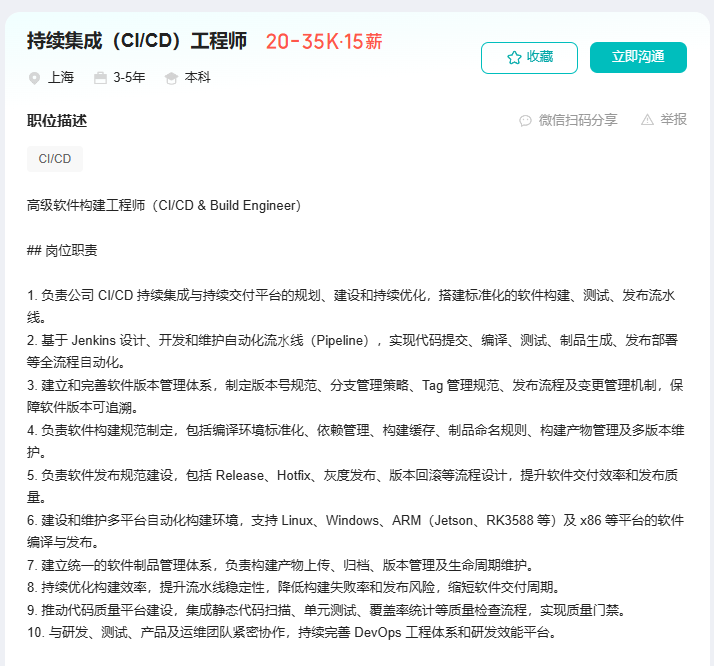

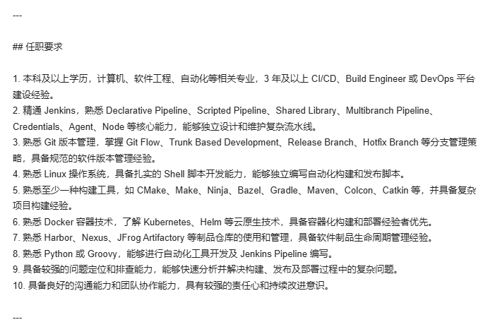

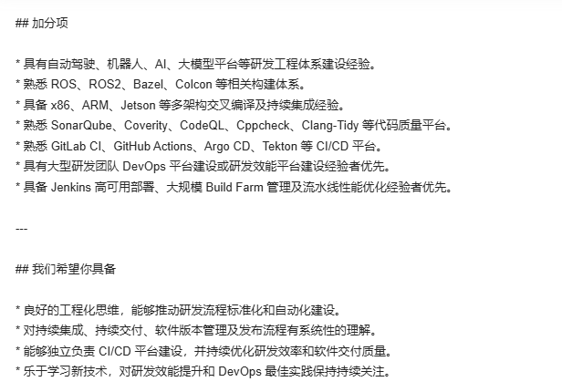

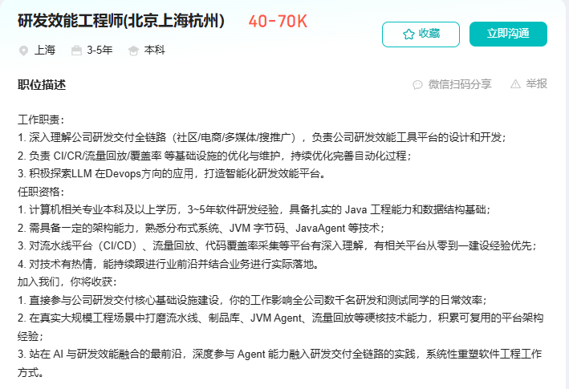

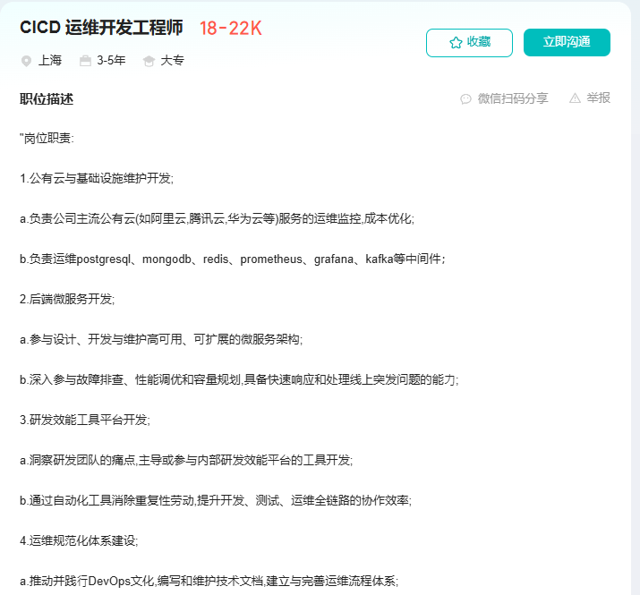


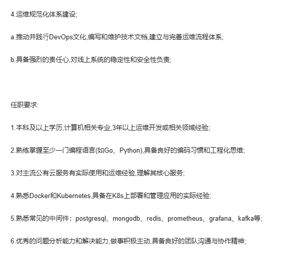


## 本阶段的核心技术能力

###  1、6 个核心维度的概念

#### 1. 流水线模型与控制概念（Pipeline Control Concepts）

理解流水线如何将任务进行逻辑拆分与顺序控制：

- **Pipeline（流水线）**：一次完整的自动化构建、测试与发布流程。
- **Stage（阶段）**：流水线的大步骤划分（如：`Lint`-->`Build` -->`Test` -->`Package`），Stage 之间通常是串行执行。（lint:把代码里隐蔽的小毛病、潜在漏洞“粘”出来.主要作用是**在不运行代码的情况下，自动检查代码中的语法错误、潜在 Bug、代码风格问题和不规范写法**）
- **Job / Task（任务）**：Stage 内部的具体工作单元。同一个 Stage 内的多个 Job 可以并行运行。
- **Step（步骤）**：Job 内部的最原子指令（如运行一条 `npm run build` 或 `git clone`）。
- **DAG（有向无环图）**：打破传统阶梯式串行 Stage，根据任务间的依赖关系（`needs`）实现最大程度并发调度的算法模型。
- **Matrix / Strategy（矩阵构建）**：通过配置组合（如不同 Node.js 版本 $\times$ 不同操作系统），一次性并发拉起多条分支流水线进行兼容性测试。

#### 2. 代码库与触发机制概念（Git & Trigger Concepts）

理解 CI 如何感知代码变化并与 Git 研发流深度融合：

- **Webhook**：Git 托管平台（GitHub/GitLab）在发生代码变更时，向 CI 系统发送的 HTTP POST 事件通知。
- **Git Workflows（Git 工作流）**：主干开发（Trunk-Based）、GitFlow、PR/MR 驱动开发模式等。
- **Git Context Variables**：CI 运行时的环境变量（如 Commit ID、Branch Name、PR/MR ID、Committer），用于驱动动态逻辑。
- **Git Commit Hook / Pre-commit**：在代码提交到本地或推送到远端前执行的轻量级检查。

#### 3. 环境隔离与容器化概念（Container & Execution Concepts）

理解任务运行时的环境隔离与资源调度：

- **CI Runner / Agent / Worker**：真正接收任务并执行 Shell 命令的节点。

- **Ephemeral Runner（一次性/即用即销毁节点）**：构建任务结束后立即销毁容器/Pod，确保环境无污染、无残留。

- **Multi-stage Build（多阶段构建）**：在 Dockerfile 中通过多个 `FROM` 语句，将编译环境与运行环境分离，极大地精简最终镜像体积。

- **Docker Socket Binding (`/var/run/docker.sock`) vs DinD (Docker-in-Docker)**：在 CI 容器内部构建新的 Docker 镜像时的两种主流底层隔离机制。

  - 核心区别对比

    | **维度**          | **Docker Socket Binding (DooD / Socket 挂载)**               | **DinD (Docker-in-Docker)**                                  |
    | ----------------- | ------------------------------------------------------------ | ------------------------------------------------------------ |
    | **工作原理**      | 将宿主机的 `/var/run/docker.sock` 挂载到容器内部，容器内部的 Docker CLI 直接向**宿主机 Daemon** 发送指令。 | 在容器内部运行一个**完全独立**的新 Docker Daemon 守护进程。  |
    | **Daemon 关系**   | **共享宿主机 Daemon**                                        | **完全隔离**（容器套容器）                                   |
    | **容器层级关系**  | 容器内创建的新容器，实际上是**宿主机的兄弟容器**（非子容器）。 | 容器内创建的新容器，是嵌套在该容器内部的**子容器**。         |
    | **镜像/缓存共享** | 与宿主机共享镜像和构建缓存，拉取镜像极快，磁盘占用小。       | 隔离的镜像存储，必须重新拉取/构建，磁盘占用高。              |
    | **运行权限**      | 容器本身不需要 `--privileged` 提权模式（但拿到 Socket 等同于拥有宿主机 root 权限）。 | 必须开启 `--privileged` 特权模式，运行在复杂的 Linux Namespace/Cgroups 隔离下。 |
    | **典型案例**      | Jenkins/GitLab Runner 构建代理、Portainer 容器管理面板。     | CI/CD 平台的完全隔离构建环境（如 GitHub Actions Runner、Kubernetes 中的隔离测试）。 |

#### 4. 数据与缓存控制概念（Data & Storage Concepts）

理解如何处理构建过程中的数据流动与提速：

- **Cache（依赖缓存）**：跨构建/跨流水线复用不经常变动的文件（如 `node_modules`、Maven 依赖库、Go build cache），解决网速瓶颈。
- **Artifact（构建产物）**：同一条流水线中，上游 Job 生成并传递给下游 Job 使用的文件（如编译出的 `.jar` 包、前端 `dist` 目录）。
- **Workspace / Persistent Volume**：同一 Job 内部各个 Step 共享的工作目录或 K8s 共享存储卷。
- **Remote Cache（远程编译缓存）**：针对 C++/Go/Java 等大语言，将中间编译字节码/目标文件上传至 S3/MinIO，实现团队间“一人编译，所有人复用”。

#### 5. 质量门禁与安全概念（Quality & Security Concepts）

理解如何在流水线中自动化把控代码质量：

- **SAST（静态应用安全测试）**：不运行代码，直接扫描源码中的语法错误、潜在 Bug 与安全漏洞（如 SonarQube、ESLint）。
- **SCA（软件成分分析）**：扫描代码依赖的开源第三方库，检测已知 CVE 安全漏洞与开源协议风险（如 Snyk、Trivy）。
- **Code Coverage（代码覆盖率）**：单元测试对代码逻辑的覆盖比例（包含行覆盖率、分支覆盖率），通常配合门禁卡点（如低于 80% 阻止合并）。
- **Secrets Masking / Injection**：凭据（API Token、数据库密码）在流水线中的安全注入与日志自动脱敏。

#### 6. 研效度量与可观测性概念（DevEx Metrics Concepts）

转向研效后，你需要从数据视角证明 CI 带来的价值：

- **DORA Metrics（DORA 4 大效能指标）**：
  1. **Deployment Frequency (DF)**：部署频率。
  2. **Lead Time for Changes (MLT)**：变更前置时间（从代码提交到上线）。
  3. **Change Failure Rate (CFR)**：变更失败率。
  4. **Time to Restore Service (MTTR)**：服务恢复时长。
  
- **Build Duration & Queue Time**：构建耗时与排队耗时（判定 CI 集群资源是否瓶颈的核心指标）。

- **Flaky Tests（不稳定测试）**：代码没变但偶尔成功、偶尔失败的单测，是损害开发者对 CI 信任度的首要元凶。

  - 一、 Flaky Tests 产生的主要原因

    Flaky Tests 很少是测试框架本身的 Bug，绝大多数源于**测试用例的设计漏洞**或**对异步/不确定性环境的假设错误**：

    1. 异步处理与硬编码等待（Concurrency & Hardcoded Timeouts）

    - **现象**：测试代码中使用固定休眠时间（如 `sleep(3000)`）等待异步操作（API 请求、数据库写入、UI 渲染）。
    - **根因**：CI 节点的 CPU/内存负载波动，会导致异步任务耗时不稳定。当 CI 节点卡顿、耗时超过 3 秒时，测试即宣告失败。

    2. 状态未隔离与测试用例偶合（Test Dependency & Pollution）

    - **现象**：测试 A 跑完后在数据库中插入了数据，测试 B 假设数据库是干净的；或者测试 A 改变了全局变量/环境变量，导致测试 B 随机失败。
    - **根因**：多个测试用例共享了全局状态（数据库、缓存、静态变量、文件系统），且用例间缺乏严格的初始化与清理（Setup/Teardown）机制。在并行运行（Parallel Execution）或乱序运行时极其容易触发。

    3. 时间与随机性依赖（Time & Randomness Dependencies）

    - **现象**：涉及日期计算、时区转换、随机数生成的测试，在特定时间段（如跨零点、跨月、闰年、时区切换）会概率性失败。
    - **根因**：代码逻辑直接调用了 `System.currentTimeMillis()` 或 `Math.random()`，未对时间和随机种子进行 Mock/Stub。

    4. 外部服务与网络不稳定（External Service & Network Flakiness）

    - **现象**：测试直接依赖真实的三方服务（如支付网关、短信 API）或公共网络资源。
    - **根因**：网络抖动、三方服务限流、超时或服务短暂宕机，均会导致 CI 中的测试失败。

    5. 资源竞争与死锁（Resource Race Conditions）

    - **现象**：并发测试同时竞争共享资源（如固定端口、临时文件名、数据库锁）。
    - **根因**：缺乏对并发资源的动态分配机制（如使用固定端口 `8080`），多进程/多线程同时测试时产生冲突。

    二、 CI/CD 中治理 Flaky Tests 的最佳实践

    治理 Flaky Tests 是一项系统工程，需要结合**自动化检测、隔离机制、规范修复以及文化建设**。

    **1.1. 识别与自动隔离（Detect & Quarantine）：**第一优先级：防止 Flaky 测试阻断整体研发流程。

    - **自动重试与标记（Retry & Tagging）**：在 CI 配置中引入重试机制（如重试 2-3 次）。如果首次失败但重试成功，自动将该用例标记为 `Flaky`，**但不阻断流水线合并**。
    - **自动隔离（Quarantine / Quarantine Suite）**：将高频 Flaky 的测试自动移出标准质量门禁（Blocker Suite），放入专门的“隔离区”独立运行，避免破坏开发者对 CI 绿条的信任。

    **2.2. 归因分析与技术重构（Fix Root Causes）：**针对常见根因进行技术手段重构。

    - **改硬等待为显式轮询（Explicit Waiting / Polling）**：淘汰 `sleep()`，改用带有超时的条件等待库（如 Java 的 `Awaitility`、Playwright 的 `waitForSelector`），一旦满足条件立即返回，高效且稳定。
    - **严格的环境隔离与 数据 Mock（Mocking & Isolation）**：
      - **单元/集成测试**：使用容器化临时数据库（如 `Testcontainers`）或打桩工具（如 WireMock），切断对外依赖。
      - **状态重置**：确保每个测试用例运行前都执行数据 Wipe/Truncate，或者在独立的数据库事务中运行并在结束时回滚（Rollback）。
    - **冻结时间（Mock Date/Time）**：使用 `Clock` 注入或 Mock 工具固定当前系统时间（如 `Timecop`），消除时间敏感性。

    **3.3. 机制保障与左移治理（Prevent & Monitor）：**防止新的 Flaky Tests 流入主干代码。

    - **压力测试（Stress Testing / Chaos Testing）**：在新编写的测试用例合入主干前，在 CI 中对其进行 **N 次重复并行运行（如运行 50 次）**，只有 100% 通过才允许合入主干。
    - **Flaky Dashboard 与趋势度量**：建立研效度量看板，统计 Flaky 用例的 Top 榜单、发生频率、影响的流水线数量，将其作为质量治理的指标。
    - **明确责任归属（Ownership）**：自动化将 Flaky Test 的归属指派给编写该测试的团队或个人，设置解决超时阈值（如 3 天内不修复则自动禁用该测试）。


### 2、需掌握的技术工具和核心知识点

#### 1. 容器化与沙箱构建（必备底层工具）

- **Docker**：
  - 编写高效的 `Dockerfile`（合理排序指令以最大化复用 Layer 缓存）。
  - 掌握**多阶段构建（Multi-Stage Builds）**，分离编译环境与运行环境，精简镜像体积。
  - 熟练使用 `.dockerignore` 排除非必要文件，加快 Context 上传速度。
- **Docker Compose**：用于在本地或 CI 节点中一键拉起轻量级的测试依赖环境（如 Redis、MySQL、MinIO）。

#### 2. 主流 CI 引擎与流水线编排（自动化载体）

- **GitLab CI / GitHub Actions / Jenkins**（至少精通其中 1-2 个）：
  - 编写声明式配置文件（`.gitlab-ci.yml` 或 `.github/workflows/*.yml`）。
  - 掌握DAG（有向无环图）逻辑（如 GitLab CI 的 `needs`），打破阶梯式串行构建。
  - 掌握**Matrix（矩阵构建）**，实现多语言版本/多环境的并发验证。
  - 掌握 **Secrets & Variables** 的配置与安全注入（如日志中的 Sensitive Token 脱敏）。

#### 3. 代码质量与安全扫描工具（门禁拦截）

- **SonarQube**：
  - 集成 `sonar-scanner` 到 CI 流水线中。
  - 配置并自定义 **Quality Gates（质量红线）**，设置覆盖率、Bug 数、重复率拦截标准。
- **ESLint / Checkstyle / GolangCI-Lint**：配置语言专属的静态代码检查门禁。
- **Trivy / Snyk**：用于扫描 Docker 镜像与第三方依赖库（SCA）的已知 CVE 安全漏洞。

#### 4. 构建提速与依赖缓存（最容易出业绩的方向）

- **语言包管理器缓存**：
  - **npm / pnpm / yarn**：配置 `node_modules` 缓存与离线镜像（Offline Mirror）。
  - **Maven / Gradle**：配置 `~/.m2/repository` 或 Gradle Build Cache 的持久化与复用。
  - **Go Modules**：配置 `GOPATH/pkg/mod` 及 Go Build Cache 的跨构建挂载。
- **MinIO / AWS S3**：搭建轻量级对象存储，用于保存和拉取分布式编译/依赖缓存。

#### 5. Git 托管平台与 Webhook 机制（事件驱动）

- **GitLab / GitHub / Gitee**：
  - 理解 **Git Flow** 与 **Trunk-Based Development（主干开发）**。
  - 配置与解析 **Webhook** 报表（基于 `push`、`merge_request`/`pull_request` 事件精确触发）。
  - 配置分支保护规则（Branch Protection Rules），将 CI 流水线状态作为合并代码的必要条件（Status Check）。
