## 替换镜像

```
# 进入家目录
cd ~

# 备份原来的配置文件
sudo cp /etc/apt/sources.list /etc/apt/sources.list.bak

# 使用清华镜像源替换默认源
# 修改 主软件仓库源
sudo sed -i 's/archive.ubuntu.com/mirrors.tuna.tsinghua.edu.cn/g' /etc/apt/sources.list
# 修改 安全更新源
sudo sed -i 's/security.ubuntu.com/mirrors.tuna.tsinghua.edu.cn/g' /etc/apt/sources.list

# 再次更新列表
sudo apt update
```

 

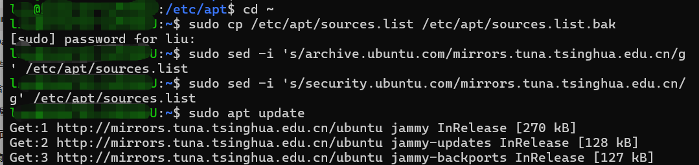

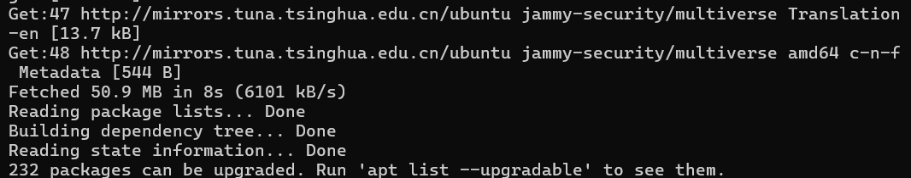


### 安装docker

由于是**首次安装**，直接在 Ubuntu 终端中按顺序运行以下步骤即可：

**1.1. 安装基础依赖工具：**约 10 秒。

运行以下命令，安装下载镜像和管理证书所需的工具：

Bash

```
sudo apt update
sudo apt install -y ca-certificates curl gnupg
```

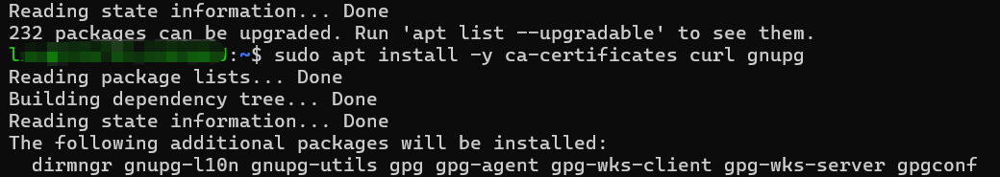

*Verification:* 输出 `Setting up...` 且没有 `Err:` 报错，提示安装完成。

**2.2. 添加 Docker 官方密钥与软件源：**约 5 秒。

把 Docker 官方的 GPG 密钥和软件源配置写入 Ubuntu 系统中：

Bash

```
sudo install -m 0755 -d /etc/apt/keyrings
curl -fsSL https://download.docker.com/linux/ubuntu/gpg | sudo gpg --dearmor -o /etc/apt/keyrings/docker.gpg
sudo chmod a+r /etc/apt/keyrings/docker.gpg

echo \
  "deb [arch=$(dpkg --print-architecture) signed-by=/etc/apt/keyrings/docker.gpg] https://download.docker.com/linux/ubuntu \
  $(. /etc/os-release && echo "$VERSION_CODENAME") stable" | \
  sudo tee /etc/apt/sources.list.d/docker.list > /dev/null
```

*Verification:* 运行 `cat /etc/apt/sources.list.d/docker.list` 能看到正确的 `download.docker.com` 源配置。

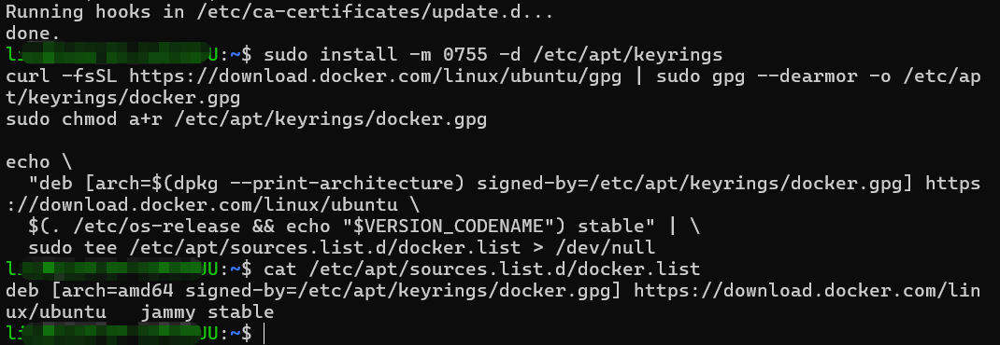

**3.3. 一键安装 Docker 核心组件：**约 30 秒。

更新软件列表并正式安装 Docker 引擎、命令行工具和 Compose 插件：

Bash

```
sudo apt update
sudo apt install -y docker-ce docker-ce-cli containerd.io docker-buildx-plugin docker-compose-plugin
```

*Verification:* 运行 `docker --version`，能够打印出版本号（如 `Docker version 27.x.x, build ...`）。

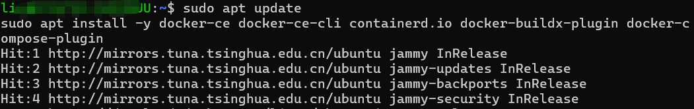

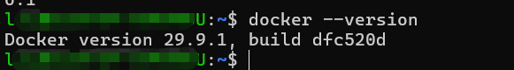


**4.4. 启动 Docker 服务并验证：**关键步骤。

在 WSL 中启动后台服务，并跑一个官方测试容器：

Bash

```
# 启动 Docker 服务
sudo service docker start

# 查看docker状态
sudo service docker status

# 运行测试容器
sudo docker run hello-world
```

*Verification:* 终端输出 `Hello from Docker! This message shows that your installation appears to be working correctly.` 即代表安装成功。

这里我出现了问题，Docker显示ok，但实际上并未启动

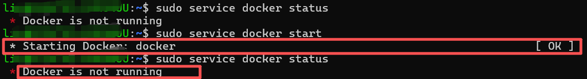


```

# 查看真正的报错信息
sudo dockerd
```

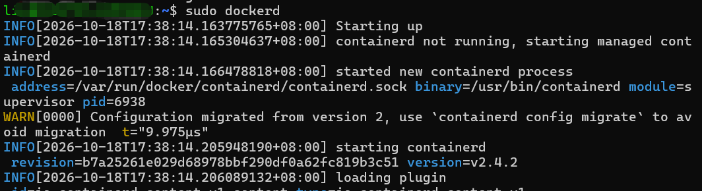

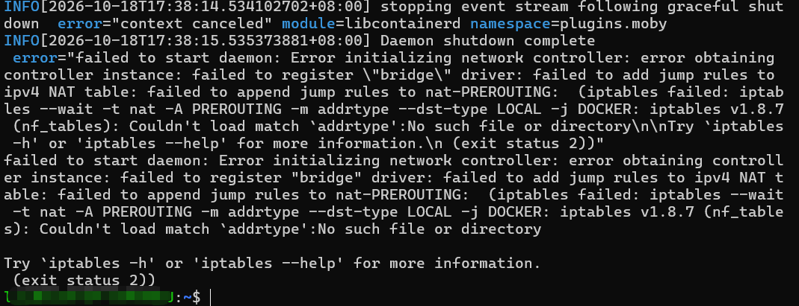

这是 WSL 2 中非常经典的冲突：**Docker 依赖传统的 `iptables-legacy` 驱动，但 Ubuntu 22.04 默认使用了新的 `nftables` 驱动**，导致 Docker 无法初始化网络并闪退

按照以下步骤将系统的 `iptables` 切换为 legacy 模式即可修复：

**1.1. 将 iptables 切换为 legacy 模式：**命令行切换。

在 Ubuntu 终端运行以下命令，修改系统默认的防火墙工具链：

Bash

```
sudo update-alternatives --config iptables
```

命令行会弹出一个选择列表：

Plaintext

```
  Selection    Path                        Priority   Status
------------------------------------------------------------
* 0            /usr/sbin/iptables-nft       20        auto mode
  1            /usr/sbin/iptables-legacy    10        manual mode
  2            /usr/sbin/iptables-nft       20        manual mode
```

**请输入 `1` 并按回车**（选择 `iptables-legacy`）。

*Verification:* 运行 `iptables -V`，输出中包含 `(legacy)` 字样（如 `iptables v1.8.7 (legacy)`）。

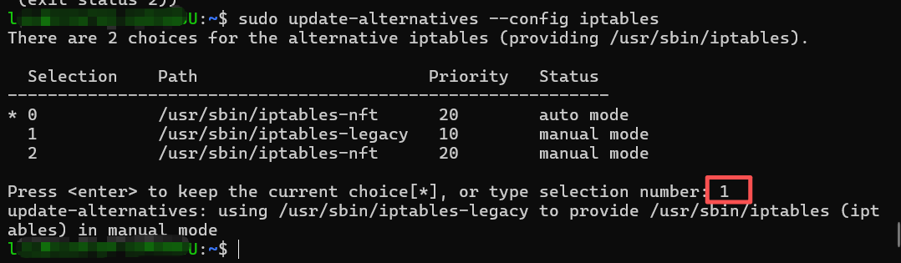

**2.2. 重新启动 Docker 服务：**启动服务。

切换完成后，再次启动 Docker 服务：

Bash

```
sudo service docker start
```

*Verification:* 运行 `sudo service docker status`，此时输出 `* Docker is running`，不会再自动退出了！

**3.3. 运行测试容器：**运行测试。

运行 hello-world 测试容器：

Bash

```
sudo docker run hello-world
```

*Verification:* 终端顺利输出 `Hello from Docker!` 说明 Docker 引擎完全正常启动运行。

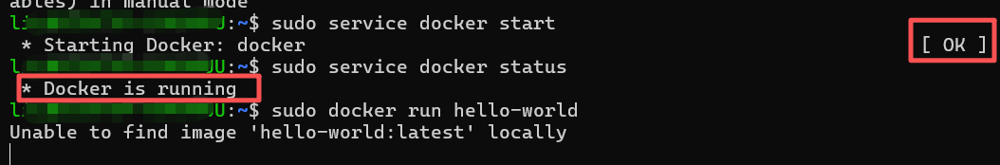

现在 Docker 服务已经正常运行了！当前报错 `dial tcp ... connect: connection refused` 是因为国内网络无法直接连接 Docker 官方默认的镜像仓库（`docker.io`）

配置国内的 Docker 镜像加速源，让 Docker 改从国内的镜像站拉取资源即可解决该问题。

**3.3.1. 创建/修改 daemon.json 配置文件：**

在 Ubuntu 终端运行以下命令，将国内镜像加速地址写入 Docker 配置文件：

Bash

```
sudo mkdir -p /etc/docker
sudo tee /etc/docker/daemon.json <<'EOF'
{
  "registry-mirrors": [
    "https://docker.m.daocloud.io",
    "https://noohoch2.mirror.aliyuncs.com",
    "https://huecker.io",
    "https://dockerhub.timeweb.cloud"
  ]
}
EOF
```

*Verification:* 运行 `cat /etc/docker/daemon.json`，能正确打印出包含 `registry-mirrors` 的文件内容。

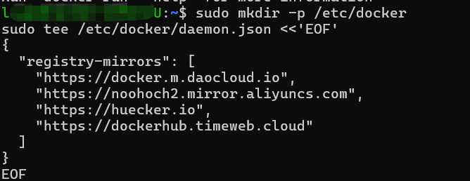

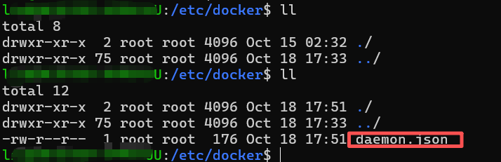

**3.3.2. 重启 Docker 服务加载配置：**

运行以下命令重启 Docker 服务：

Bash

```
sudo service docker restart
```

*Verification:* 运行 `sudo service docker status`，显示 `* Docker is running`。

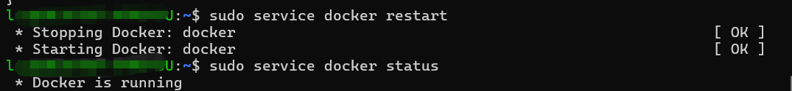

**3.3.3. 重新运行 hello-world 测试：**测试。

再次尝试拉取并运行测试镜像：

Bash

```
sudo docker run hello-world
```

*Verification:* 终端输出 `Hello from Docker! This message shows that your installation appears to be working correctly.` 即代表 Docker 彻底配置成功并可正常使用！

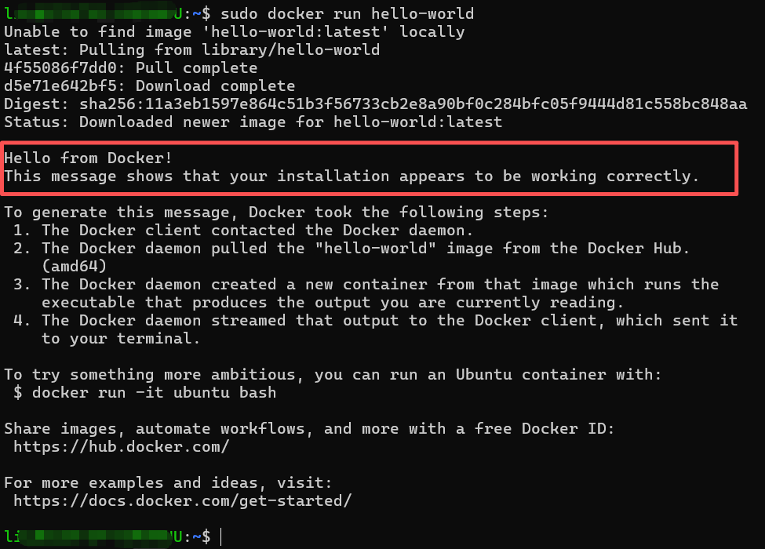

**5.5. 配置免 sudo 运行（强烈建议）：**可选配置。

默认每次运行 `docker` 都需要输入 `sudo`，运行以下命令把当前用户加入 `docker` 组：

Bash

```
sudo usermod -aG docker $USER
newgrp docker
```

*Verification:* 现在无需加 `sudo`，直接运行 `docker ps` 或 `docker run hello-world` 也能正常执行。


### 关闭docker

```
sudo service docker stop
```

