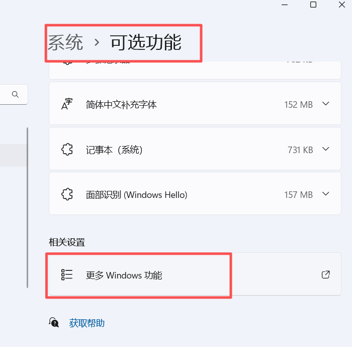

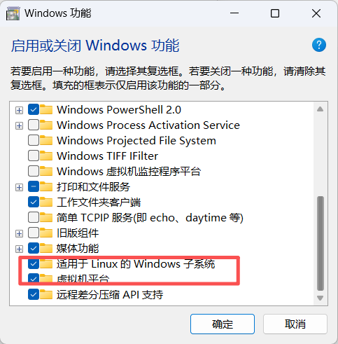

勾选上述两个选项后重启电脑，安裝相关内容 

重启后，可在cmd中运行wsl -l  和 wsl --list --online

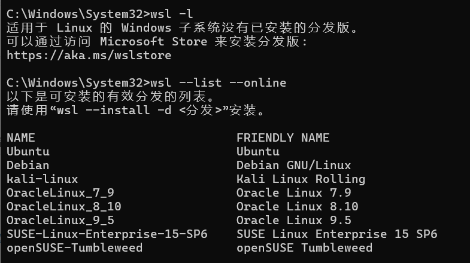


我不想在c盘安装，于是选择通过微软官方提供的 **安装包（`.appx` / `.AppxBundle`）** 进行离线解压安装

1、下载Ubuntu安装包到E盘（比较慢，且我这步报错了，所以我又采用另一种下载方式）

打开 PowerShell，直接运行以下命令将官方包下载到 E 盘目录：

```powershell
Invoke-WebRequest -Uri https://aka.ms/wslubuntu2204 -OutFile E:\WSL\Ubuntu2204.appx -UseBasicParsing
```

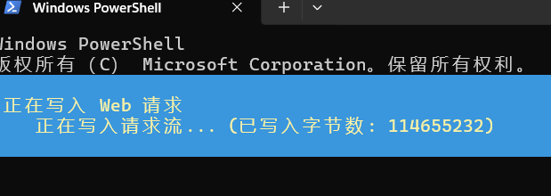

（我这里报错了，如果没错的可以继续往下看，我采用的另一种下载方式补充在后面）

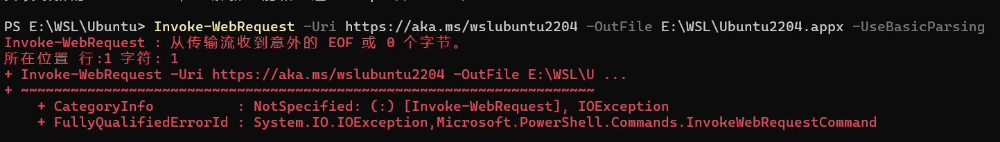

下载完成后，检查 `E:\WSL` 目录下是否存在 `Ubuntu2204.appx` 文件


2、修改后缀并解压安装包

运行以下命令将 `.appx` 修改为 `.zip` 并解压到 `E:\WSL\Ubuntu` 文件夹：

```powershell
Rename-Item E:\WSL\Ubuntu2204.appx E:\WSL\Ubuntu2204.zip
Expand-Archive E:\WSL\Ubuntu2204.zip -DestinationPath E:\WSL\Ubuntu
```

打开 `E:\WSL\Ubuntu` 目录，能看到里面包含了 `ubuntu.exe` 和若干系统文件


3、运行启动程序完成首次注册

在 PowerShell 中进入该目录并运行启动程序：

```
cd E:\WSL\Ubuntu
.\ubuntu.exe
```

终端会提示 `Installing, this may take a few minutes...`，随后要求设置全新的 UNIX 用户名和密码。设置完成后直接进入 Linux 命令行即代表安装成功


**说明：**

1. 通过这种方式安装后，Ubuntu 的所有虚拟磁盘文件（`ext4.vhdx`）将直接生成并存储在 `E:\WSL\Ubuntu` 目录下，后续占用空间全在 E 盘。
2. 安装完成后，可以直接删掉第一步下载的 `E:\WSL\Ubuntu2204.zip` 文件以释放空间。


### 补充另一种下载方式

迅雷搜索 https://aka.ms/wslubuntu2204 下载


下载完成后，

**1、在 `E:\WSL` 文件夹里把下载好的文件重命名为 `Ubuntu2204.zip`**。

**2、右键 `Ubuntu2204.zip` 选择“全部解压缩”**（或者在 PowerShell 中运行解压命令）。解压后打开文件夹，你会看到里面有几个类似 `Ubuntu_..._x64.appx` 和 `Ubuntu_..._arm64.appx` 的文件。

*Verification:* 能在解压后的文件夹里看到名字带 **`_x64.appx`** 的文件。

**3.把 _x64.appx 再改名并解压到 E:\WSL\Ubuntu：**定位核心安装文件。

1. 把 `Ubuntu_..._x64.appx` 这个文件的后缀也改为 `.zip`（例如改为 `x64.zip`）。

2. 将 `x64.zip` 解压到目标路径 **`E:\WSL\Ubuntu`** 中。

   *Verification:* 打开 `E:\WSL\Ubuntu` 文件夹，里面能直接看到 `ubuntu.exe` 文件。

**4.双击或运行 ubuntu.exe：**完成安装。

进入 `E:\WSL\Ubuntu` 文件夹，双击运行 **`ubuntu.exe`**，等待初始化完成并设置你的用户名和密码，系统即成功安装在 E 盘！

（如果有问题请接着往下看，是否和我出现了一样的问题）

### 修复问题

我运行后，显示有错误，我的系统缺少 WSL 2 所必须的 Linux 内核更新包

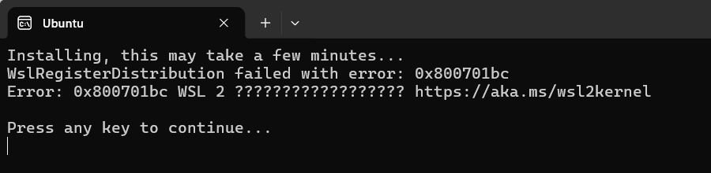


https://wslstorestorage.blob.core.windows.net/wslblob/wsl_update_x64.msi


### 解决办法（仅需 2 步）

不需要重新下载那 1GB 的安装包，只需下载并安装微软官方的内核补丁即可。

**1.下载并安装 WSL 2 内核更新包：**官方更新包。

在浏览器中直接打开以下微软官方链接，下载内核更新程序：

👉 **[点击下载微软官方 WSL2 内核更新包](https://wslstorestorage.blob.core.windows.net/wslblob/wsl_update_x64.msi)**

下载完成后，双击运行下载好的 `wsl_update_x64.msi`，一路点击“Next（下一步）”完成安装。

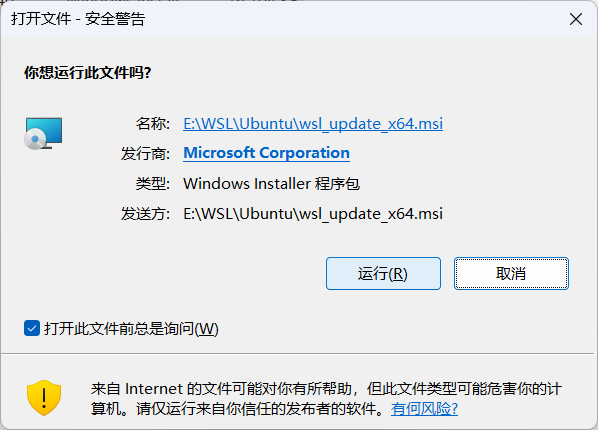

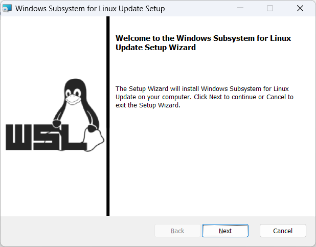

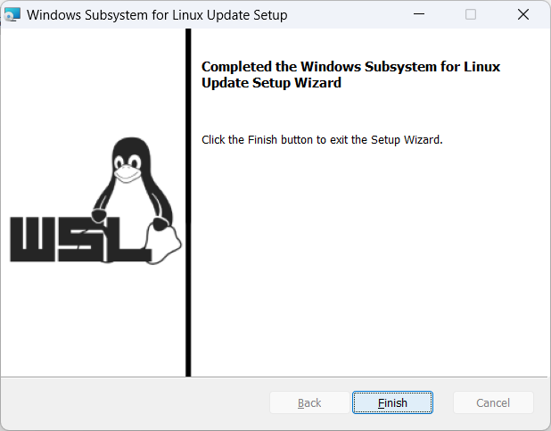


*Verification:* 安装过程非常快（几秒钟），提示“Finish”即表示 Linux 内核组件已补全。

**2.重新运行 ubuntu.exe：**重新初始化。

返回你的 `E:\WSL\Ubuntu` 文件夹，再次双击 **`ubuntu.exe`**。

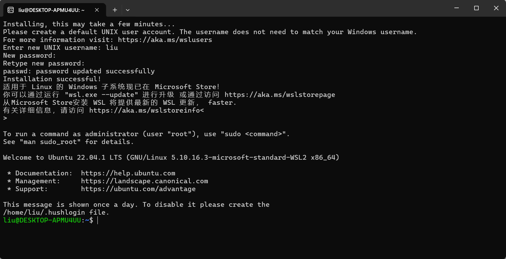

*Verification:* 此时不会再报错，等待片刻后就会顺利提示你输入 `Enter new UNIX username:`（设置新的用户名），输入用户名和密码后即可正常进入 Linux 系统！


查看状态和版本

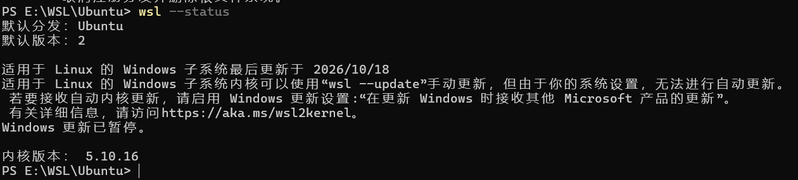